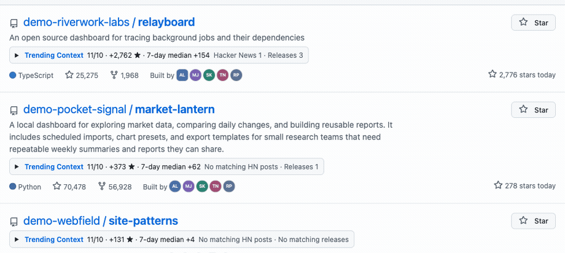

<h1 align="center">Trending Context</h1>

<p align="center">
  See when stars jumped and what happened around that date, directly in GitHub Trending.
</p>

<p align="center">
  <a href="https://github.com/gay00ung/github-trending-context/actions/workflows/checks.yml"></a>
  <a href="https://developer.chrome.com/docs/extensions/develop/migrate/what-is-mv3"></a>
  <a href="https://www.python.org/"></a>
  <a href="https://developer.mozilla.org/docs/Web/JavaScript"></a>
  <a href="LICENSE"></a>
</p>

<p align="center"><a href="#try-it-locally">Try it locally</a> · <a href="#what-the-data-means">Methodology</a> · <a href="#development">Development</a></p>

<p align="center">
  
</p>

The demo uses fictional repository names and source links in the GitHub Trending interface. [View the expanded panel as a still image](docs/media/expanded.png).

## What you see

- A summary below each repository description in the daily, all-language top 10. GitHub controls the list and its order.
- A 14-day star chart with the most recent comparable spike highlighted, plus links to matching Hacker News posts and releases.
- A collection timestamp and separate states for missing history, unavailable sources, and snapshots that are over 36 hours old.

## Try it locally

You need Chrome and Python 3.12 or later. The collector uses the Python standard library and public endpoints.

```sh
git clone https://github.com/gay00ung/github-trending-context.git
cd github-trending-context
python3 -m collector
python3 scripts/package_extension.py \
  --snapshot build/site/latest.json \
  --output build/trending-context-local
```

1. Open `chrome://extensions` and turn on **Developer mode**.
2. Choose **Load unpacked** and select `build/trending-context-local`.
3. Open [GitHub Trending](https://github.com/trending) with the period set to **Today** and the language filters cleared. Select a **Trending Context** summary to see its evidence.

The local build reads the snapshot bundled with it. To refresh it, run the commands again with a fresh output directory and load that directory in Chrome. To explore the UI without fetching data, run `python3 scripts/package_extension.py --demo --output build/trending-context-demo` and load that build instead.

## What the data means

| Signal | How it is collected |
| --- | --- |
| Trending position | Read in order from GitHub's public daily Trending page at collection time. |
| Daily stars | GitHub's aggregate star history. The comparison ends two UTC calendar days before collection because the API does not guarantee UTC-aligned day boundaries. Missing days remain gaps. |
| Spike | At least 100 stars on a day, and at least five times the median of the preceding seven calendar days with data. With a median of zero, the 100-star threshold applies. The panel uses the most recent day that meets the rule. |
| Nearby public activity | Up to ten recent GitHub releases and the first twenty date-filtered Hacker News search results, checked within one calendar day on either side of the spike. A Hacker News result must link to the repository. |

The panel reports what was observed and when. A matching release or discussion can provide context for a spike. The available data cannot determine whether stars were purchased or where all visitors came from.

[GitHub star history](https://docs.github.com/en/rest/activity/starring#get-repository-star-history) · [GitHub releases](https://docs.github.com/en/rest/releases/releases#list-releases) · [Hacker News Search API](https://hn.algolia.com/api)

## Hosted snapshots

The source extension uses the project's GitHub Pages `latest.json` endpoint when Pages is enabled. The **Refresh snapshot** workflow collects the data daily and supports manual runs. A failed collection leaves the last successful deployment available. The extension requests the same JSON for everyone, caches the last valid copy locally, and keeps browsing activity on the device.

For maintainers, enable **Settings → Pages → Source → GitHub Actions** in the public repository, then run **Refresh snapshot** from the Actions tab. The workflow publishes the feed and builds an unpacked extension artifact. The local install above works before Pages is enabled.

## Development

JavaScript powers the Manifest V3 extension. Python handles collection and packaging. GitHub Actions runs the checks and publishes the static feed.

```sh
python3 -m unittest discover -s tests -p 'test_*.py'
node --test tests/extension.test.cjs
```

Node.js is needed for the JavaScript tests. When reporting a UI issue, include the Trending URL and what the panel displayed. For a data issue, include the repository name and the collection timestamp shown in the expanded panel.

Distributed under the [MIT License](LICENSE).
